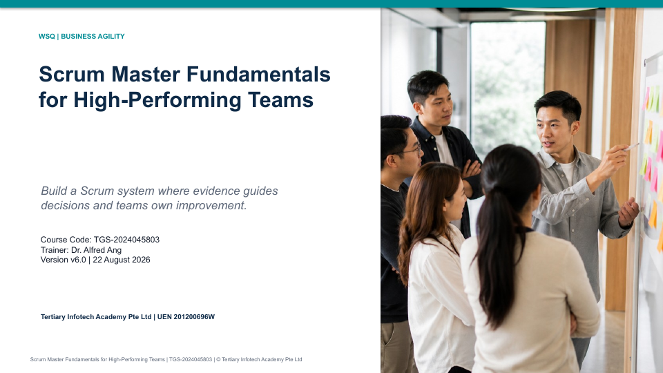

# Scrum Master Fundamentals for High-Performing Teams

[](https://www.tertiarycourses.com.sg/wsq-scrum-master-fundamentals-for-high-performing-teams.html)
[](https://scrumguides.org/docs/scrumguide/v2020/2020-Scrum-Guide-US.pdf)
[](activities/)

Public learner resources for the two-day WSQ course **Scrum Master Fundamentals for High-Performing Teams**, developed by Tertiary Infotech Academy Pte. Ltd.

| Course detail | Information |
|---|---|
| Course code | `TGS-2024045803` |
| Programme | WSQ |
| Duration | 2 days / 16 hours |
| Registration | [View course details and register](https://www.tertiarycourses.com.sg/wsq-scrum-master-fundamentals-for-high-performing-teams.html) |
| Funding | Up to 70% course fee funding: 50% baseline for Singapore Citizens and PRs aged 21+, up to 70% for Singapore Citizens aged 40+ (MCES) and SME-sponsored employees. Eligibility and terms apply; see the course page for current fees. |
| Provider | Tertiary Infotech Academy Pte Ltd (UEN 201200696W) |



## What is included

- A 150-slide, concept-led trainer deck in PowerPoint and PDF
- A detailed Learner Guide with activity procedures and evidence requirements
- A two-day Lesson Plan aligned to the five learning outcomes
- Ten self-contained activity packs with PDF guidance, Excel worksheets, checklists, scenarios, and mock data
- Editable native charts for burndown, burnup, and cycle-time interpretation

## Learning outcomes

Learners will be able to:

1. Implement Agile Scrum practices to analyse business requirements.
2. Manage Scrum role responsibilities in accordance with organisational policies.
3. Measure and experiment through Scrum events and change-management methods.
4. Organise and assess work using Scrum project-management practices.
5. Share information using Scrum artefacts and information radiators.

## Repository structure

```text
.
├── courseware/                 # PPTX/PDF deck, Learner Guide, Lesson Plan
├── activities/                 # Ten independent learner activity packs
├── SOURCE-COVERAGE-v6.0.md     # Source and visual-asset register
├── QA-REPORT-v6.0.md           # Release QA evidence
└── screenshot.png              # Courseware preview
```

## Activities

| # | Activity | Primary evidence |
|---|---|---|
| 01 | Diagnose Scrum Foundations at HarborHealth | Framework diagnosis and feedback loop |
| 02 | Create Accountabilities and Working Agreements | Accountability map and team agreement |
| 03 | Coach a Team Through an Impediment | Impediment map and coaching plan |
| 04 | Facilitate Sprint Planning and a Sprint Goal | Sprint Goal and forecast |
| 05 | Redesign the Daily Scrum Around Flow | Flow-focused facilitation canvas |
| 06 | Turn a Sprint Review into Stakeholder Collaboration | Review agenda and stakeholder map |
| 07 | Interpret Burn Charts and Flow Metrics | Metric interpretation sheet and charts |
| 08 | Run an Evidence-Based Retrospective | Retrospective evidence board and experiment |
| 09 | Order a Product Backlog with Customer Evidence | Ordered Product Backlog and rationale |
| 10 | Capstone Scrum Master Facilitation Plan | Integrated facilitation and improvement plan |

Every folder can be used independently. Start with its `README.pdf`, open the scenario and checklist, then complete the Excel worksheet. The browser-based [Scrum activity tool](https://alfredang.github.io/scrum/) supports the exercises.

## Source basis

The course uses the official [Scrum Guide 2020](https://scrumguides.org/docs/scrumguide/v2020/2020-Scrum-Guide-US.pdf) as its framework authority and draws practical perspectives from Scrum.org, Scrum Alliance, Scaled Agile, Atlassian, Asana, Coursera, and TechTarget. See [SOURCE-COVERAGE-v6.0.md](SOURCE-COVERAGE-v6.0.md) for the full register.

## Privacy boundary

Assessment papers and answer keys are intentionally excluded from this public repository. Candidate assessment papers are distributed through the authorised course platform; answer keys remain trainer-only.

## Developed by

[Tertiary Infotech Academy Pte. Ltd.](https://www.tertiarycourses.com.sg/)

